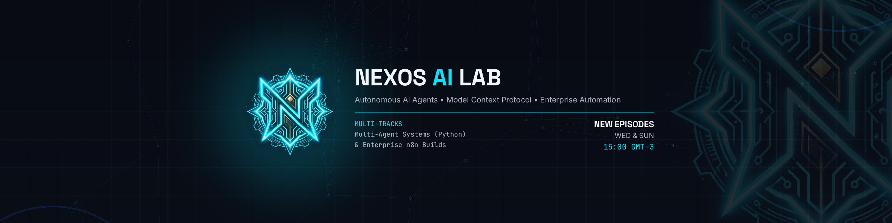

  

    

  
  
  
  

  

    <strong>Production-grade AI engineering, distributed multi-agent systems, and deterministic automation.</strong>
  

---

Welcome to the official GitHub organization of **Nexos AI Lab** ([@NexosAILab](https://github.com/NexosAILab)). We design, benchmark, and open-source resilient AI architectures for production environments—cutting through the hype to deliver deterministic, high-throughput systems without framework bloat.

## 🧭 Engineering Disciplines

Our production systems and starters are organized into two primary technical tracks:

### 1. 🤖 Multi-Agent Systems (Python + MCP)
- Decentralized micro-agent swarms built with Python 3.12, FastAPI, and native AsyncIO concurrency.
- Standardized protocol abstraction and tool decoupling using Anthropic's **Model Context Protocol (MCP)**.
- Fault-tolerant coordination, deterministic state persistence, and native timezone synchronization (`zoneinfo`).

### 2. ⚡ Enterprise Automation & n8n Builds
- Self-healing enterprise automation pipelines with zero UTC drift and explicit iteration governors.
- High-throughput webhook ingestion, strict payload normalization, and enterprise state sync.
- Comprehensive retry budgets, dead-letter routing, and automated rollback triggers.

---

## 📦 Open Source Starters & Benchmark Catalog

All starter repositories adhere to our strict engineering invariant: **100% passing `pytest` test suites**, lightweight Zero-DB backends, deterministic time normalization, and individual **Social Preview (1280×640 px PNG: `social_preview_1280x640.png`)** assets configured for rich link previews across social platforms and embedded directly in their documentation.

| Repository | Engineering Track | Architecture & Capabilities | Episode Reference | Release Status |
| :--- | :---: | :--- | :--- | :---: |
| [**`distributed-state-mcp-starter`**](https://github.com/NexosAILab/distributed-state-mcp-starter) | Multi-Agent Systems | Distributed state persistence in SQLite WAL, idempotency keys, and self-healing worker recovery loops with effectively-once semantics | [VID_004: Crash-Proof State & MCP Checkpoints](https://www.youtube.com/watch?v=aPLZh4miItU) | 🚀 *Scheduled Premiere: Sun Nov 29, 2026 · 12:00 PM GMT-3 (9/9 PASS)* |
| [**`hybrid-rag-mcp-starter`**](https://github.com/NexosAILab/hybrid-rag-mcp-starter) | Multi-Agent Systems | Zero-DB Hybrid RAG server in pure Python with BM25, vectors, RRF, and deterministic hallucination gate (24/24 PASS) | [VID_003: Build Hybrid RAG MCP Server](https://www.youtube.com/watch?v=eIiIE4SeRHM) | 🚀 *Scheduled Premiere: Sun Nov 22, 2026 · 12:00 PM GMT-3* |
| [**`multi-agent-mcp-starter`**](https://github.com/NexosAILab/multi-agent-mcp-starter) | Multi-Agent Systems | Production template for distributed micro-agents in Python with FastMCP, FastAPI, and ZoneInfo calendar sync | [VID_002: Build Multi-Agent System](https://www.youtube.com/watch?v=Q4apC-tffJc) | ✅ *Live in Production* |
| [**`autonomous-agent-starter`**](https://github.com/NexosAILab/autonomous-agent-starter) | Enterprise Automation | Production-ready self-healing autonomous agent starter workflow for n8n with loop governors and state persistence | [VID_001: Build First AI Agent in 15 Minutes](https://www.youtube.com/watch?v=hI8xuR7S49U) | ✅ *Live in Production* |

> 📌 **Visual Assets & Media Architecture:**  
> • **Organization Header Banner:** Panoramic 4:1 image (`github_header_banner.jpg` — 2560×640 px) displaying global broadcast schedule: **Sundays & Wednesdays at 12:00 PM (GMT-3)**.  
> • **Starter Repositories:** Dedicated 2:1 Social Preview image (`social_preview_1280x640.png` — 1280×640 px PNG) per repository, embedded in each `README.md` and set in GitHub repository settings (*Settings ➔ General ➔ Social preview*).

---

## 🌐 Official Channels & Resources

- **Official Web Hub:** [https://nexosailab.vercel.app](https://nexosailab.vercel.app)
- **YouTube Channel:** [@NexosAILab](https://www.youtube.com/@NexosAILab)
- **Official X (Twitter):** [@NexosAILab](https://x.com/NexosAILab)
- **GitHub Organization:** [NexosAILab](https://github.com/NexosAILab)
- **Engineering Inquiries:** [engineering@nexosailab.com](mailto:engineering@nexosailab.com)
